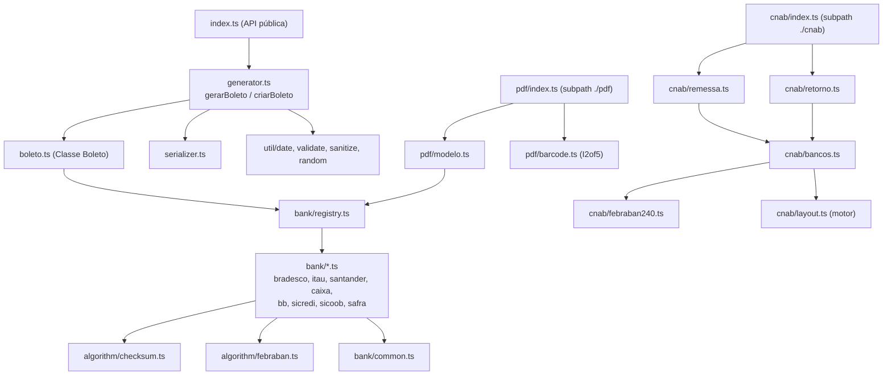

# Arquitetura de Projeto — @box4dev/gerador-boleto

## Propósito

Biblioteca NPM para **boletos bancários** no padrão **FEBRABAN**: linha digitável, código de barras, PDF e arquivos CNAB 240 de remessa e retorno. Suporta 8 bancos: **Bradesco**, **Itaú**, **Santander**, **Caixa**, **Banco do Brasil**, **Sicredi**, **Sicoob** e **Safra**.

## Arquitetura

## Princípios

| Princípio                       | Como                                                                                  |
| ------------------------------- | ------------------------------------------------------------------------------------- |
| Nunca truncar dado bancário     | `util/validate.ts#digitos` aceita zeros à esquerda e lança erro para dígitos a mais   |
| Input não confiável             | `util/sanitize.ts` descarta `__proto__`/`constructor`; lookups usam `Object.hasOwn`  |
| Produção ≠ massa de teste       | `criarBoleto` é estrito; `gerarBoleto` preenche aleatoriamente com dados coerentes    |
| Layout CNAB declarativo         | FEBRABAN 240 + `substituir()` por banco; `validarLayout` garante 1..240 sem lacunas   |
| Zero dependências no núcleo     | `pdfkit` é peer dependency opcional, usado só por `./pdf`                             |

## Datas

Datas de boleto são datas de calendário (meia-noite UTC internamente). `DD/MM/AAAA` e `AAAA-MM-DD` são literais; ISO com hora usa a data escrita; `Date` com hora usa o calendário de Brasília. O fator de vencimento segue a regra FEBRABAN com reinício em 22/02/2025.

## Bancos Suportados

| Banco     | Código | Carteiras (massa de teste)  | NN (sem DV)              | CNAB 240 |
| --------- | ------ | --------------------------- | ------------------------ | -------- |
| Bradesco  | 237-2  | 09, 04, 06, 21, 22, 25, 26, 19 | 11                    | sim      |
| Itaú      | 341-7  | 104, 109, 112, 175          | 8                        | sim      |
| Santander | 033-7  | 101, 102, 201, 104          | 12                       | sim      |
| Caixa     | 104-0  | 14, 24                      | 15 (ou 17 com prefixo)   | sim      |
| BB        | 001-9  | 17, 18                      | 10 / 5 / 7 / 17 conforme convênio | sim |
| Sicredi   | 748-X  | 1                           | 8 (ano + byte + seq.)    | sim      |
| Sicoob    | 756-0  | 1                           | 7                        | sim      |
| Safra     | 422-7  | 1                           | 8                        | não      |
